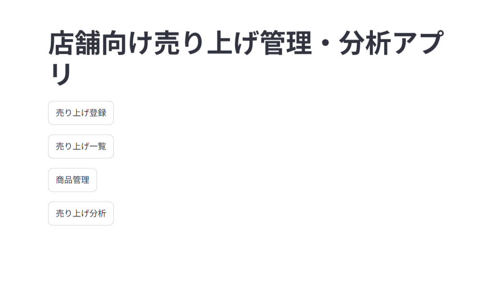
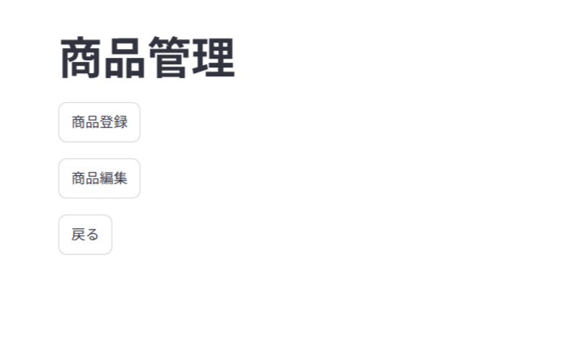
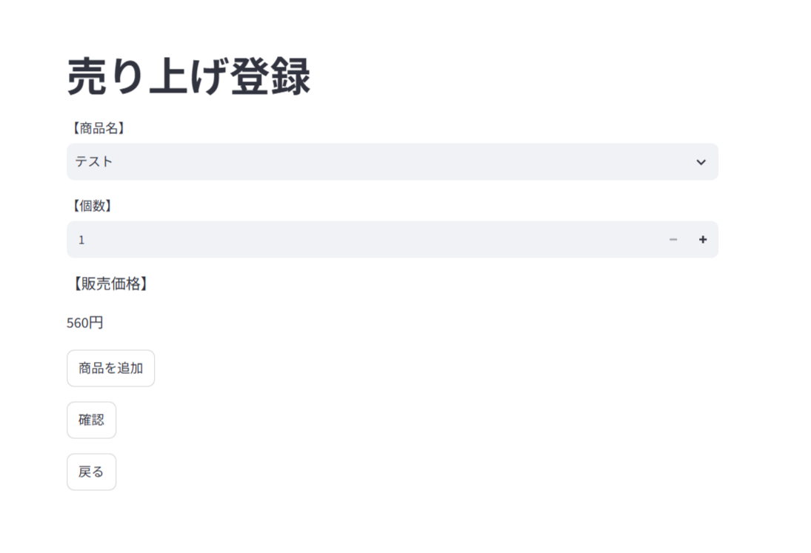
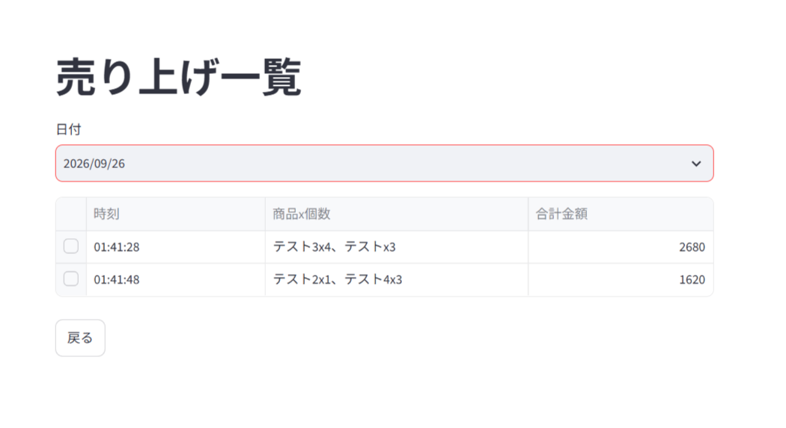
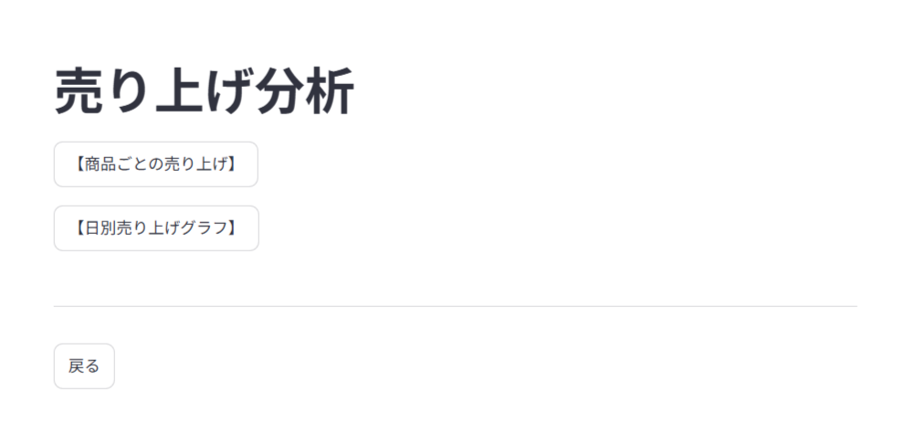

# 店舗向け売り上げ管理・分析アプリ

## 概要

店舗での商品管理や売り上げ管理を行うことを想定して開発したWebアプリケーションです。

商品の登録・編集、売り上げの登録・確認・編集・削除に加え、商品ごとの売り上げ集計や日別の売り上げグラフを確認できます。

Python、Streamlit、SQLite、pandasを使用して開発しました。

## 使用技術

- Python
- Stremlit
- SQLite
- pandas

## 主な機能

### 商品管理

- 商品の登録

- 商品情報の編集

- 販売ステータスの管理

### 売り上げ管理

- 売り上げの登録

- 複数商品の同時登録

- 売り上げ一覧の確認

- 会計詳細の確認

- 会計内容の編集

- 会計の削除

### 売り上げ分析

- 商品ごとの月間売り上げ集計

- 日別売り上げグラフ

## 画面紹介

### ホーム画面

アプリの各機能へ移動するためのメニュー画面です。

### 商品管理画面

商品の登録や編集、販売ステータスの管理を行います。

### 売り上げ登録画面

商品を選択して個数を入力し、複数の商品をまとめて売り上げとして登録できます。

### 売り上げ一覧画面

指定した日付の売り上げを一覧で確認できます。
会計を選択することで、会計詳細の確認や編集・削除を行えます。

### 売り上げ分析画面

商品ごとの売り上げ集計や、日別の売り上げをグラフで確認できます。

## データベース設計

SQLiteを使用して、商品情報・会計情報・会計ごとの商品明細を管理しています。

### テーブル構成

#### product

商品情報を管理するテーブルです。

- 商品ID
- 商品名
- カテゴリ
- 販売価格
- 販売ステータス

#### payment

1回の会計情報を管理するテーブルです。

- 会計ID
- 会計日時

#### sales_detail

会計ごの商品明細を管理するテーブルです。

- 明細ID
- 会計ID
- 商品ID
- 個数
- 販売時の価格

### テーブル間の関係

- payment と sales_detail は1対多の関係
- product と sales_detail は1対多の関係
- sales_detail が payment と product を関連付けています

## 工夫した点・学んだこと

### データベース設計

商品情報・会計情報・会計明細を別々のテーブルで管理し、主キー・外部キーを利用してテーブル同士を関連付けました。

### 売り上げデータの取得

`JOIN`を使用して複数のテーブルから必要な情報を取得し、売り上げ一覧や会計詳細を表示できるようにしました。

### 売り上げ分析

SQLの`GROUP BY`や`SUM`を使用して商品ごとの売り上げを集計し、pandasを使用してデータを表示しました。

また、日別の売り上げデータをグラフ化し、売り上げの推移を確認できるようにしました。

### 画面間のデータ管理

Streamlitの`session_state`を使用して、画面遷移時に商品情報や会計情報などの必要なデータを保持できるようにしました。

### 開発中の仕様変更への対応

開発を進める中で、実際の操作や使いやすさを考慮して画面構成や処理内容を変更しました。

変更した内容を仕様書にも反映し、実装と仕様書の内容が一致するように調整しました。